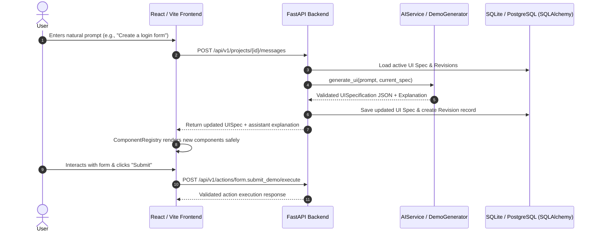

# UPGW Architecture & Design Specification

## Overview

**Universal Personalized Generative Web (UPGW)** is a chat-driven, full-stack platform for generating, personalizing, and executing interactive web interfaces and workflows from natural language.

---

## The Three Product Modes

### Mode A: Standalone Generative Web (MVP)
A chat-first application where users converse with AI to generate, test, and refine interactive web apps.
- **Chat-First UI**: Minimal conversational starting screen without predefined dashboard clutter.
- **Specification Schema**: JSON schema describing pages, components, layout, state bindings, and allowlisted actions.
- **Component Registry**: Whitelisted components rendered dynamically via fixed React code without arbitrary code execution.
- **Incremental Patching**: Stable component IDs allow targeted updates (e.g. "add a phone field", "switch theme to green") while preserving form input state.
- **Deterministic Demo Engine**: Offline deterministic fallback that serves rich UI flows even when AI provider keys are not configured.

### Mode B: Existing Website Adaptation (Browser Extension MVP)
A Chrome Manifest V3 browser extension for safe webpage customization.
- **Zero Arbitrary Execution**: Only fixed operations (`adjust_font_size`, `enhance_readability`, `apply_color_theme`, `highlight_content`, `simplify_layout`, `inject_reader_panel`) are executed.
- **Undo / Restore**: Full inline style and class restoration.
- **Security Boundaries**: Restricted on sensitive internal browser pages and banking sites.

### Mode C: Website Owner Integration (Future)
An embeddable widget or SDK contract allowing third-party sites to embed UPGW generative personalizer panels.

---

## Architectural Data Flow

---

## Safe Component Registry

The frontend NEVER interprets or executes arbitrary JavaScript or raw HTML scripts. Components are mapped from validated JSON tokens to hardened React components:
- Container, Section, Heading, Text
- Button, TextInput, EmailInput, PasswordInput, NumberInput
- Select, Checkbox, RadioGroup, Textarea
- Form (with isolated form state and real reset/submit handlers)
- Card, Badge, Table, Tabs, Dialog, Drawer
- Navigation, Alert, Divider, Progress, Chart, Image, Grid, FlexRow, FlexCol
